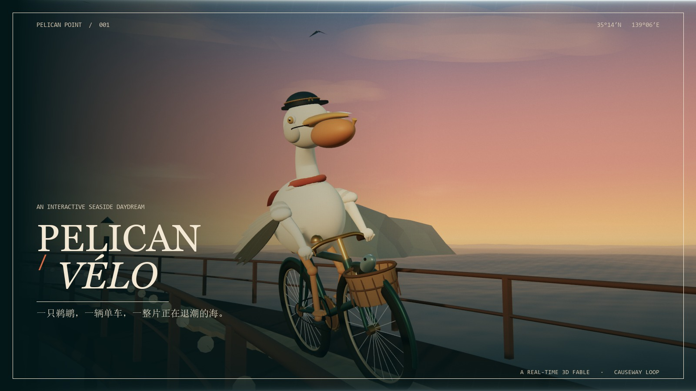

# Pelican / Vélo

**A real-time 3D seaside daydream.**  
一只鹈鹕，一辆单车，一整片正在退潮的海。

[**→ Ride the live experience**](https://jacoryou.github.io/pelican-velo/)

[](https://jacoryou.github.io/pelican-velo/)

---

## What it is

A single-page, fully procedural WebGL experience. A pelican in a captain's cap pedals a vintage bicycle around a lighthouse causeway at golden hour. Everything is generated in the browser: no downloaded 3D models, no image textures, no video.

- **Procedural pelican & bicycle** — hand-built from Three.js geometry: layered feathers, a curved neck, a pouch that squashes when it squawks, blinking eyes, a fluttering scarf, and legs that solve an IK chain against the pedals.
- **Custom GLSL** — a multi-train ocean with sun glitter, crest foam and a shallow shoreline; a day/night sky with a rose-to-teal gradient, procedural cloud bands, stars and a moon.
- **Living world** — circling gulls, a drifting sailboat, blinking buoys, a rotating lighthouse beam, string lights and a cottage fireplace.
- **Five camera languages** — cinematic intro, follow, orbit, hero and free orbit. Drag to look, scroll to zoom.
- **Golden hour / midnight** — a full lighting and palette transition, with stars, moon, lighthouse beam and warm lanterns.
- **Web Audio soundscape** — synthesized ocean, wind, freewheel ticks, bell partials, a pelican squawk, distant gulls and a camera shutter. No audio files.
- **Photo mode** — hides the interface and exports a designed 2400 × 1350 JPEG postcard.
- **Small details** — lap timer with a persistent best lap, adaptive render quality, touch-safe responsive HUD, keyboard controls, reduced-motion support and a custom cursor.

## Controls

| Input | Action |
| --- | --- |
| `W` / `S` or `↑` / `↓` | accelerate / slow down |
| `Space` | brake |
| `C` | cycle camera |
| `B` | ring the bell |
| `N` | golden hour / midnight |
| `P` | photo mode |
| `M` | sound |
| `F` | fullscreen |
| `R` | restart the ride |
| `Esc` | close notes / photo mode |
| Drag / scroll | free orbit / zoom |
| Click the pelican | say hello |

## Run locally

```bash
npm install
npm run dev
```

Then open the local Vite URL. For a production build:

```bash
npm run build
```

The static output is written to `dist/` and uses relative asset paths, so it can be hosted from any subdirectory.

## Under the hood

- **Three.js** (r186) for geometry, lighting, shadows and the render graph.
- **EffectComposer** with Unreal Bloom, ACES tone mapping and a custom grade pass (film grain, chromatic aberration, vignette).
- **Web Audio API** with procedural noise beds, filters, envelopes and a small synthesized bell.
- **Vite** for the build; all fonts are self-hosted through Fontsource, so the experience makes zero external requests at runtime.

## Deploy

The live build is published from the `gh-pages` branch of this repository to GitHub Pages (Fastly CDN).

## Credits

Designed and built with Three.js, custom GLSL, Web Audio, a lot of trigonometry, and one very patient bird.

Code: MIT.  
Typefaces: Cormorant Garamond, Manrope and DM Mono via Fontsource, under the SIL Open Font License.
